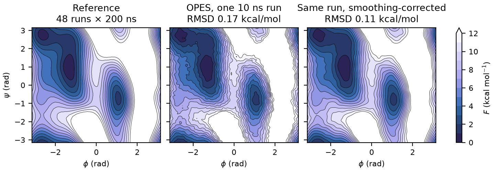
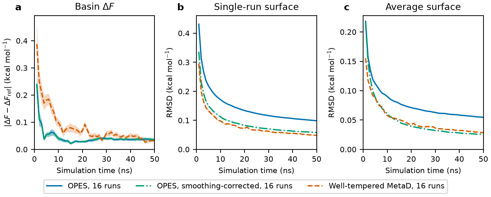

# openmm-opes

[](https://github.com/craabreu/openmm-opes/actions/workflows/ci.yml)
[](https://pypi.org/project/openmm-opes/)
[](https://pypi.org/project/openmm-opes/)
[](https://craabreu.github.io/openmm-opes)
[](LICENSE)

On-the-fly Probability Enhanced Sampling (OPES) for [OpenMM](https://openmm.org).

OPES is an enhanced sampling method that builds its bias from an on-the-fly
estimate of the probability distribution along a few collective variables,
instead of accumulating repulsive hills as metadynamics does. The bias soon
becomes nearly static, so free energies converge quickly and reweighting is
simple. It needs only an expected barrier height, a deposition stride and a
kernel bandwidth. This package implements OPES in pure Python on top of
OpenMM, in the spirit of `openmm.app.Metadynamics`, and is validated against
PLUMED's `OPES_METAD` and `OPES_METAD_EXPLORE`.

## Features

- **OPES and OPES-explore,** following Invernizzi and Parrinello, with fixed,
  adaptive or warm-up bandwidths and on-the-fly kernel compression.
- **OPES and OPES-explore combined** (OPES_COM, Ray and Rizzi), as a single
  `CombinedOPES` sampler that computes the collective variables once per step.
- **Multiple walkers** sharing one bias through a directory.
- **Several samplers on one simulation,** with extra biases folded into the
  reweighting, like PLUMED's `EXTRA_BIAS`.
- **Reweighting tools:** the reweighting constant c(t), and PLUMED's `rct` as a
  convergence check.
- **Smoothing-corrected free energy surfaces,** which remove the bias of the
  kernel density estimate and lower the noise of a single run.
- **Periodic, unbounded or reflective collective variables,** one to three of
  them.
- **Checkpoints** through `getState` and `setState`.

## Installation

```bash
pip install openmm-opes
```

It needs Python 3.11 or later and OpenMM 8.1 or later. OpenMM can also come
from conda-forge:

```bash
conda install -c conda-forge openmm
pip install openmm-opes
```

## Quick start

Alanine dipeptide in vacuum, biased along its backbone dihedrals φ and ψ. The
structure is
[`alanine-dipeptide.pdb`](benchmarks/alanine-dipeptide/alanine-dipeptide.pdb)
from this repository.

```python
import numpy as np
import openmm
from openmm import app, unit

from openmm_opes import OPES

pdb = app.PDBFile("alanine-dipeptide.pdb")
system = app.ForceField("amber14-all.xml").createSystem(
    pdb.topology,
    nonbondedMethod=app.NoCutoff,
    constraints=app.HBonds,
    hydrogenMass=4 * unit.amu,
)


def dihedral(*atoms):
    force = openmm.CustomTorsionForce("theta")
    force.addTorsion(*atoms, [])
    return app.BiasVariable(force, -np.pi, np.pi, 0.15, True, 101)


phi, psi = dihedral(4, 6, 8, 14), dihedral(6, 8, 14, 16)
sampler = OPES(
    system,
    [phi, psi],
    temperature=300 * unit.kelvin,
    barrier=50 * unit.kilojoules_per_mole,
    frequency=250,  # one kernel per ps
    varianceFrequency=None,  # fixed initial bandwidth, from biasWidth
    biasFactor=10,
)

integrator = openmm.LangevinMiddleIntegrator(
    300 * unit.kelvin, 1 / unit.picosecond, 4 * unit.femtoseconds
)
simulation = app.Simulation(pdb.topology, system, integrator)
simulation.context.setPositions(pdb.positions)
simulation.minimizeEnergy()

sampler.step(simulation, 2_500_000)  # 10 ns
fes = sampler.getFreeEnergy(correctSmoothing=True)  # kJ/mol on the 101 x 101 grid
```

`CombinedOPES` takes the same arguments plus an `exploreBarrier`, and
`OPES(..., exploreMode=True)` gives OPES-explore. The
[quickstart](https://craabreu.github.io/openmm-opes/latest/quickstart/) covers
bandwidths, multiple walkers, extra biases and the combined sampler.

## Benchmarks

<picture>
  <source media="(prefers-color-scheme: dark)" srcset="benchmarks/alanine-dipeptide/figures/overview-dark.png">
  
</picture>

The free energy surface of alanine dipeptide in vacuum, left, from a reference
computed for this benchmark. Next to it is the surface a single 10 ns OPES run
reports, before and after the smoothing correction. Its RMS deviation from the
reference, where the reference is below 5 kcal/mol, drops from 0.17 to
0.11 kcal/mol, typical of the 16 runs in the benchmark.

<picture>
  <source media="(prefers-color-scheme: dark)" srcset="benchmarks/alanine-dipeptide/figures/convergence-dark.png">
  
</picture>

For alanine dipeptide in vacuum, OPES converges the free energy difference
between basins several times faster than OpenMM's well-tempered metadynamics,
based on 16 independent runs of each method evaluated against an accurate
reference surface. With the smoothing correction
(`getFreeEnergy(correctSmoothing=True)`), OPES also achieves comparable
accuracy in the full free energy surface.

The
[alanine dipeptide benchmark](benchmarks/alanine-dipeptide)
includes convergence results, single-run comparisons, and the reference
surface. Additional benchmarks comparing this implementation with PLUMED's
OPES are available in
[benchmarks/plumed](benchmarks/plumed).

## Documentation

- [Quickstart](https://craabreu.github.io/openmm-opes/latest/quickstart/): a
  runnable example and the main options.
- [Theory](https://craabreu.github.io/openmm-opes/latest/theory/): how the
  code maps onto the published equations, and where it departs from them.
- [API reference](https://craabreu.github.io/openmm-opes/latest/api/).

## Citing

If you use openmm-opes, please cite the papers behind the methods you use:

- OPES: M. Invernizzi and M. Parrinello, J. Phys. Chem. Lett. 11, 2731 (2020),
  [doi:10.1021/acs.jpclett.0c00497](https://doi.org/10.1021/acs.jpclett.0c00497).
- OPES-explore: M. Invernizzi and M. Parrinello, J. Chem. Theory Comput. 18,
  3988 (2022),
  [doi:10.1021/acs.jctc.2c00152](https://doi.org/10.1021/acs.jctc.2c00152).
- OPES and OPES-explore combined: D. Ray and V. Rizzi, J. Chem. Theory Comput.
  21, 58 (2025),
  [doi:10.1021/acs.jctc.4c01231](https://doi.org/10.1021/acs.jctc.4c01231).
- Smoothing correction: M. C. Jones, O. Linton and J. P. Nielsen, Biometrika
  82, 327 (1995).

## Origin

This library packages and hardens the prototype implementation developed in
[craabreu/opes-simulations](https://github.com/craabreu/opes-simulations),
porting its `OPES` and `OnlineKDE` classes into a tested, documented package.

## License

MIT
