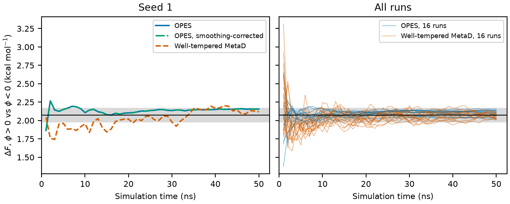
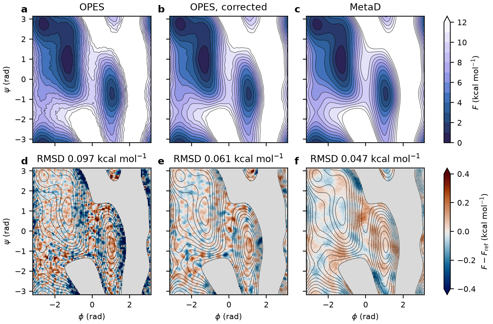

# Alanine dipeptide: OPES and metadynamics against a reference surface

How fast do openmm-opes and OpenMM's well-tempered metadynamics converge the
free energy surface of alanine dipeptide in vacuum? This benchmark measures
both against an accurate reference surface, computed here, over 16
independent runs of 50 ns each.

- **Basin free energy difference.** OPES converges it several times faster:
  its average error stays below 0.05 kcal/mol from 10 ns, against 41 ns for
  metadynamics.
- **Full surface.** The raw OPES surface is noisier and slightly smoothed, so
  it trails metadynamics. The smoothing correction of openmm-opes,
  `getFreeEnergy(correctSmoothing=True)`, closes most of that gap.
- **Reference surface.** This folder also provides an accurate free energy
  surface for alanine dipeptide in vacuum with Amber ff14SB, described below.

## Reference free energy surface of alanine dipeptide (Amber ff14SB, vacuum, 300 K)

`alanine_dipeptide_fes.dat` is a reference Ramachandran free energy surface,
F(φ, ψ), of alanine dipeptide (Ace-Ala-Nme) in vacuum with the Amber ff14SB
force field at 300 K. It is a plain-text table on a 100 × 100 grid of the
backbone dihedrals φ and ψ, in radians, with the free energy and its standard
error in kcal/mol. Use it as ground truth when testing enhanced sampling
methods such as OPES, metadynamics, umbrella sampling or adaptive biasing
force, or as a reference potential of mean force for the alanine dipeptide
Ramachandran plot. We found no published reference for this force field and
these conditions.

| Property | Value |
|---|---|
| Force field | Amber ff14SB, OpenMM `amber14-all.xml` |
| Environment | Vacuum, no cutoff |
| Temperature | 300 K, Langevin middle integrator, friction 1/ps |
| Time step | 4 fs, bonds to hydrogen constrained, hydrogen mass 4 amu |
| Collective variables | φ = C–N–Cα–C and ψ = N–Cα–C–N |
| Sampling | 48 runs × 200 ns under a fixed bias, 9.6 million samples |
| Grid | 100 × 100, from −π in steps of 2π/100 |
| ΔF, φ > 0 relative to φ < 0 | 2.0734 ± 0.0018 kcal/mol |
| Median standard error where F < 5 kcal/mol | 0.013 kcal/mol |

**How it was computed.** The bias is the converged well-tempered
metadynamics bias, averaged over four 500 ns runs and then frozen. Under a
fixed bias, reweighting each sample by e^{βV} is exact, and the bias makes
both basins and the barriers between them easy to visit. The density is
estimated with product von Mises kernels at two widths and extrapolated to
zero width, which removes the kernels' smoothing bias to leading order. A
three-point extrapolation differs from it by only 0.002 kcal/mol RMS. The
standard errors come from a jackknife over the 48 runs. The ΔF between basins
uses the weighted samples directly, with no kernel. The file's header repeats
all of this.

## Setup

The system is the one described above: alanine dipeptide in vacuum, Amber
ff14SB, 300 K, 4 fs steps with hydrogen mass repartitioning. Both methods bias
φ and ψ, deposit once per picosecond, and tabulate their bias on a 101 × 101
grid. Their settings follow the alanine dipeptide inputs of Invernizzi and
Parrinello, J. Phys. Chem. Lett. 11, 2731 (2020), PLUMED-NEST plumID:19.068.

| | OPES (openmm-opes) | Well-tempered MetaD (OpenMM) |
|---|---|---|
| Barrier or hill height | 50 kJ/mol | 1.2 kJ/mol |
| Bias factor | 10 | 10 |
| Kernel width | 0.15 rad initially, shrinking by Silverman's rule | 0.35 rad |
| Deposition stride | 250 steps, 1 ps | 250 steps, 1 ps |

Each method ran 16 times for 50 ns, from the same structure with different
random seeds. Every nanosecond, each run saved the free energy surface it
reports, and OPES runs also saved the smoothing-corrected one. Errors are
measured against the reference surface:

- **Basin ΔF error:** the absolute error of F(φ > 0) − F(φ < 0).
- **Surface RMSD:** the RMS deviation where the reference is below
  5 kcal/mol, after removing the mean offset.

## Results

### Convergence over 16 runs


**a**, The reference surface. **b**, Basin ΔF error. **c**, Surface RMSD of
single runs. **d**, Surface RMSD of the surface averaged over all 16 runs,
which removes most of the noise and leaves the systematic error. Bands in b
and c are standard errors over runs.

| At 50 ns, kcal/mol | Basin ΔF error | Single-run surface RMSD | RMSD of the average surface |
|---|---|---|---|
| OPES | 0.035 | 0.099 | 0.054 |
| OPES, smoothing-corrected | 0.035 | 0.058 | 0.025 |
| Well-tempered MetaD | 0.035 | 0.049 | 0.029 |

OPES gets the basin ΔF right far sooner: its average error stays below
0.1 kcal/mol from 3 ns and below 0.05 from 10 ns, while metadynamics needs
10 and 41 ns. By 50 ns, both are equally accurate. For the full surface, raw
OPES trails metadynamics throughout. Panel d shows why: OPES's average surface
carries a systematic error that metadynamics' does not, and the smoothing
correction removes it.

### Basin ΔF in a single run



Left, seed 1; right, all 16 runs. The black line is the reference and the
grey band spans ±0.1 kcal/mol around it. The corrected OPES curve coincides
with the raw one, because the correction keeps each basin's total weight.

A single OPES run settles within a few nanoseconds and then barely moves,
though it can keep a small offset of its own: seed 1 ends 0.08 kcal/mol high.
Single metadynamics runs wander much longer before settling.

### Surfaces from a single run



Seed 1 at 50 ns. **a–c**, The surfaces reported by OPES, by OPES with the
smoothing correction, and by metadynamics. **d–f**, Their differences from the
reference, where it is below 11 kcal/mol, which includes the transition
region between the basins. The color scale stops at ±0.4 kcal/mol, so the
largest raw OPES errors near the transition region are clipped. Panel titles
give the RMSD where the reference is below 5 kcal/mol.

Raw OPES shows grainy noise and a systematic pattern: steep walls too low
(blue) and basin floors too high (red). The correction removes the pattern
and much of the noise. On the barrier, from 8 to 11 kcal/mol, it halves the
RMS error of the 16 runs, from 0.21 to 0.11 kcal/mol. Metadynamics, at
0.08 kcal/mol there, shows broad, smooth deviations instead.

### Why OPES's surface trails, and what the correction does

OPES estimates the unbiased distribution with a weighted sum of kernels, and
any kernel estimate is the true distribution blurred by the kernels. That
blur makes basin floors too high and steep walls too low, by an amount that
grows with the kernel width squared. Silverman's rule narrows new kernels only
slowly, and old kernels keep their width, so the blur fades slowly. ΔF
between basins is immune, because blurring moves probability within a basin,
not between basins. Narrow kernels also add noise. Metadynamics' surface comes
from its bias, a sum of broad Gaussians, which is smooth and, at convergence,
nearly unbiased here.

The correction, `getFreeEnergy(correctSmoothing=True)`, uses a pilot estimate
with kernels twice as wide, divides each kernel's weight by the pilot at its
center, smooths that nearly flat ratio, and multiplies back. That removes the
blur to leading order and keeps the noise of the broad kernels low. It needs
the broadened kernels to be narrow compared with the basins, so it can do
more harm than good very early in a run, while the kernels are still wide.
Here it already helped at the first snapshot, after 1 ns. See the theory page
of the documentation.

## Reproducing

```bash
# Benchmark runs: 16 seeds per method, about 10 minutes each on one CPU core
python run.py opes SEED runs/opes_SEED.npz
python run.py metad SEED runs/metad_SEED.npz

# Reference surface: long metadynamics runs, then 48 runs under their frozen bias
python run.py metad SEED long/metad_SEED.npz --ns 500     # 4 seeds
python reference.py run long SEED static/run_SEED.npy --ns 200   # 48 seeds
python reference.py kde static reference.npz
python reference.py table reference.npz alanine_dipeptide_fes.dat

# Analysis and figures
python analyze.py runs --truth reference.npz
python figure.py runs reference.npz figures/convergence
python deltaf.py runs reference.npz 1 figures/deltaf
python surfaces.py runs reference.npz 1 figures/surfaces
```

Runs use OpenMM's Reference platform, one process per seed, so they
parallelize trivially. The results above come from openmm-opes at 35be0b0.

## Files

| File | Contents |
|---|---|
| `run.py` | One OPES or metadynamics run, saving its surface every nanosecond |
| `reference.py` | Runs under a fixed bias, the reference surface, and its table |
| `analyze.py` | Convergence metrics, printed as tables |
| `figure.py`, `deltaf.py`, `surfaces.py` | The three figures |
| `alanine_dipeptide_fes.dat` | The reference free energy surface |
| `alanine-dipeptide.pdb` | The starting structure, from OpenMM's test systems |
| `figures/` | The figures above |
